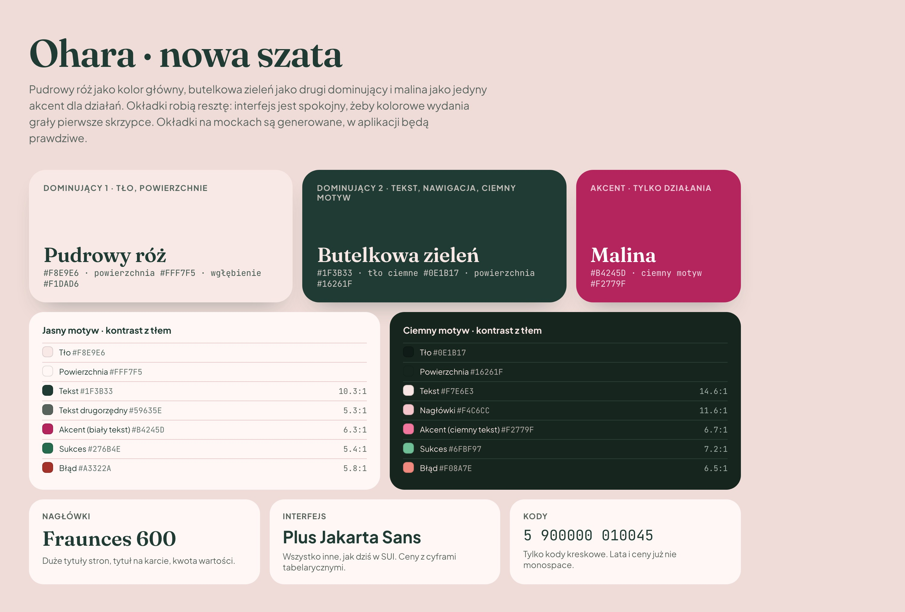

# Ohara redesign

Reference for the redesign: palette, type and mockups of every main screen. The images are
renders of `mockups.html`; open it in a browser to read exact sizes, radii and colors. Covers in
the mockups are generated shapes, the app shows real artwork.

## Palette

Powder pink is the main color, bottle green the second, and raspberry the only accent. The accent
marks actions (primary buttons, the scan button, badges, the wishlist heart) and nothing else.

| Token       | Light     | Dark      | Use                                                    |
| ----------- | --------- | --------- | ------------------------------------------------------ |
| canvas      | `#F8E9E6` | `#0E1B17` | Page background                                        |
| surface     | `#FFF7F5` | `#16261F` | Cards, sheets, list groups                             |
| inset       | `#F1DAD6` | `#1E3029` | Search field, inputs, segmented control track, sidebar |
| line        | `#E6CBC6` | `#2B4038` | Borders and separators                                 |
| ink         | `#1F3B33` | `#F7E6E3` | Primary text                                           |
| muted       | `#59635E` | `#A9B3AE` | Secondary text                                         |
| heading     | `#1F3B33` | `#F4C6CC` | Large titles                                           |
| brand       | `#1F3B33` | `#1F3B33` | Selected chips and nav items, the value hero card      |
| brand-tint  | `#F4C6CC` | `#F4C6CC` | Text and marks on brand surfaces                       |
| accent      | `#B4245D` | `#F2779F` | Primary actions                                        |
| on-accent   | `#FFFFFF` | `#0E1B17` | Text on accent                                         |
| accent-soft | `#F6D3DE` | `#3A2230` | Toggled chips, secondary accent buttons                |
| success     | `#276B4E` | `#6FBF97` | Deal under limit, alert sent                           |
| danger      | `#A3322A` | `#F08A7E` | Errors, delete                                         |

Contrast against the canvas, light / dark: ink 10.3:1 / 14.6:1, muted 5.3:1 / 8.2:1, success
5.4:1 / 8.1:1, danger 5.8:1 / 7.3:1. Accent with on-accent text: 6.3:1 / 6.7:1. Accent text on
accent-soft: 4.6:1 / 5.5:1. Success on success-soft: 5.2:1 / 5.7:1. Muted text holds 4.7:1 /
6.4:1 on inset, where SUI draws placeholders and the segmented control.

## Type

- Fraunces 600 for large page titles, the title on a detail page and the collection value.
- Plus Jakarta Sans, as in SUI, for everything else. Prices use tabular figures.
- JetBrains Mono only for barcodes.

## Screens

| Screen                   | Mockup                                           |
| ------------------------ | ------------------------------------------------ |
| Collection, light        | [collection-light.jpg](collection-light.jpg)     |
| Collection, dark         | [collection-dark.jpg](collection-dark.jpg)       |
| Scan, code found         | [scan-found.jpg](scan-found.jpg)                 |
| Scan, after adding       | [scan-added.jpg](scan-added.jpg)                 |
| Title detail             | [title.jpg](title.jpg)                           |
| Valuation                | [valuation.jpg](valuation.jpg)                   |
| Deals                    | [deals.jpg](deals.jpg)                           |
| To complete (scan queue) | [queue.jpg](queue.jpg)                           |
| Collection, desktop      | [desktop-collection.jpg](desktop-collection.jpg) |
